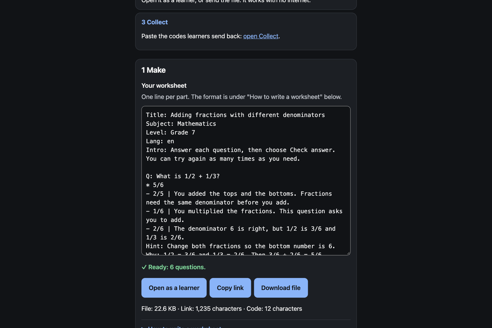
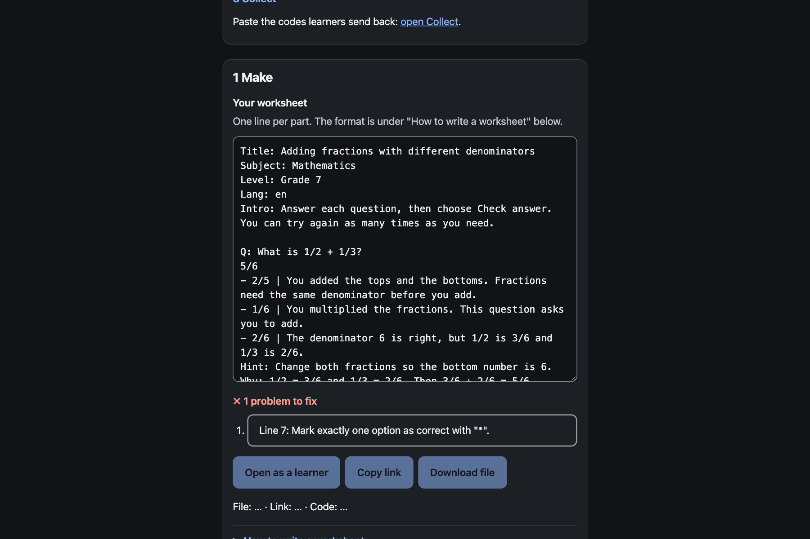
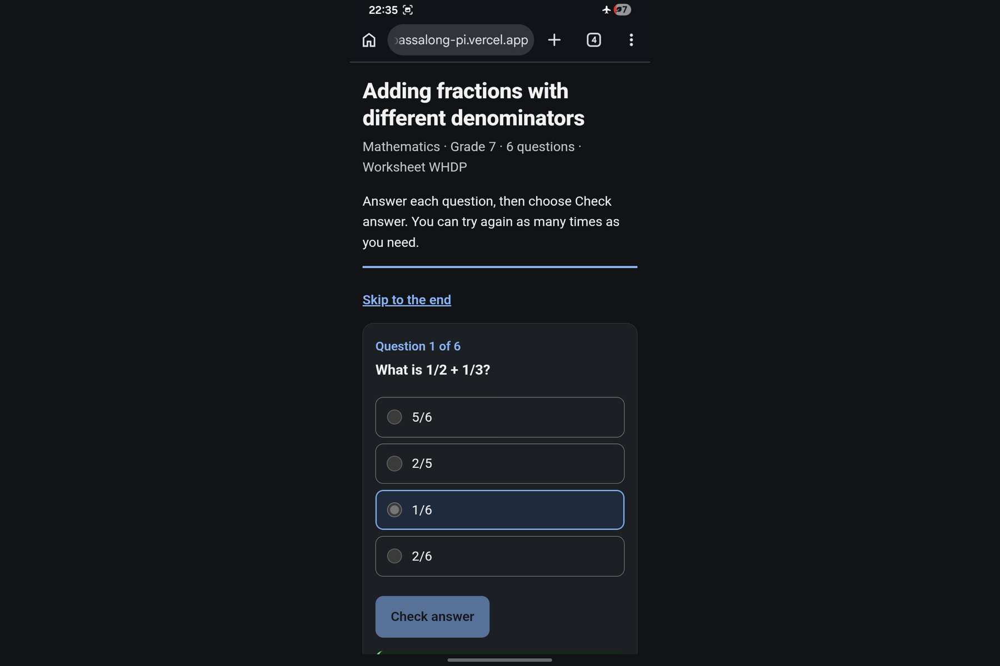
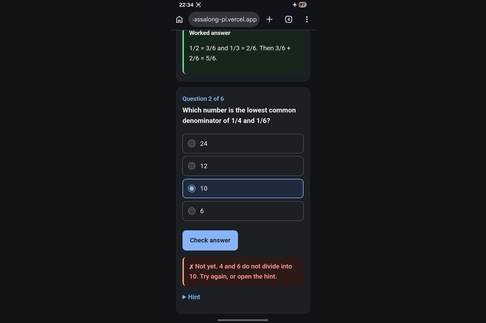
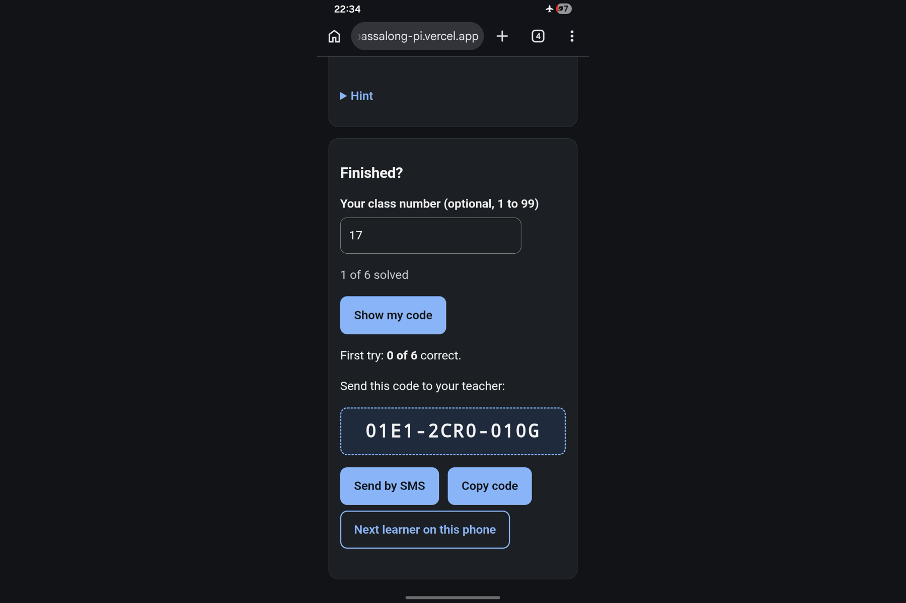
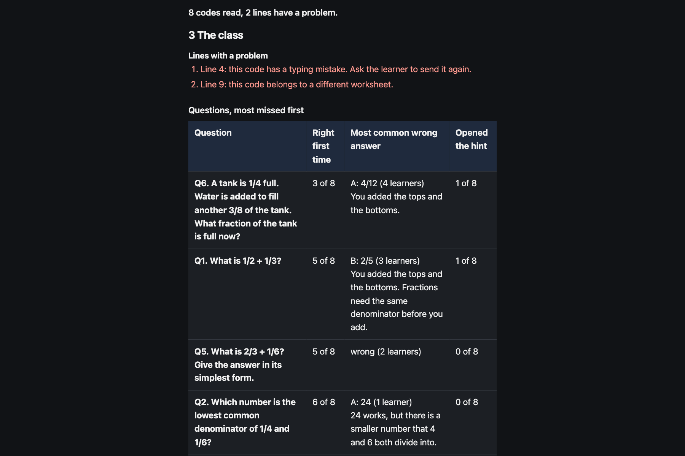
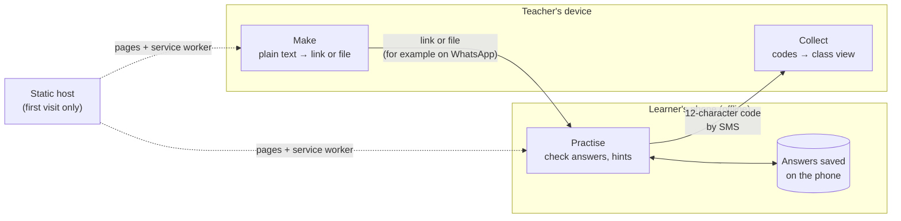

# Passalong

Worksheets that fit in a file of about 23 KB, work offline on any phone, and send answers back as a short code by SMS.

A teacher pastes a worksheet as plain text. Passalong turns it into one small file or link that works with no connection, checks each answer with feedback for the mistake made, and ends with a 12-character code the learner can text back. No accounts, no server, no AI.

**Try it:** https://passalong-pi.vercel.app · built for [AccessED Hacks](https://accessed-hacks.devpost.com/), from 14 Nov 2026.

## The learner and the barrier

**Learner:** a Grade 7 learner in rural Kenya who does homework on a parent's shared Android phone with prepaid data.

**Barrier:** the worksheet arrives as a scanned PDF. It costs data to download, cannot be answered on the phone, gives a screen reader nothing to read, and the teacher gets nothing back.

**Change:** the same worksheet as one file of about 23 KB that works in airplane mode. The learner checks each answer and gets feedback for the mistake they made. Their first answers go back to the teacher as a 12-character code in one text message.

## Try it in two minutes

1. Open https://passalong-pi.vercel.app. The sample worksheet is already in the box.
2. Choose **Open as a learner**. The worksheet opens in a new tab.
3. Turn the network off and reload. The worksheet is still there.
4. Answer question 1 wrong and read the feedback for that wrong answer, then answer it right.
5. Choose **Show my code** and copy the code.
6. Open **Collect**, paste the code (or choose **Load sample codes**) and see which questions the class missed.

Step 3 works once the page has been opened with a connection. A downloaded file works offline from the start.

## Screenshots

Taken on 15 Nov 2026 from the live site, with the sample worksheet, in dark mode. The phone shots are from a Samsung Galaxy A06 in airplane mode.

| | |
| --- | --- |
|  |  |
| **Make:** the teacher pastes plain text and sees the file size. | **Make:** a mistake is explained with its line number. |
|  |  |
| **Practise:** works on the phone in airplane mode. | **Practise:** a wrong answer gets feedback for that mistake. |
|  |  |
| **The code:** 12 characters to send by SMS. | **Collect:** which questions the class missed, and the most common wrong answer. |

## Before and after

I printed the six sample questions and scanned them with a phone's document scanner, as a teacher would.

| | Before: scanned PDF | After: Passalong file |
| --- | --- | --- |
| Size | 2,165,971 bytes (2 pages) | 23,104 bytes, about 94 times smaller |
| Works offline | Once downloaded | Yes, tested in airplane mode on a Samsung Galaxy A06 |
| Can be answered on the phone | No | Yes, with feedback for each wrong answer |
| Read by a screen reader | Nothing to read: the scan is pictures with no text layer | Tested with VoiceOver and TalkBack (see the test table) |
| Teacher sees the answers | No | Yes, as a 12-character code by SMS |

## How it works



The host only hands over the pages on the first visit. After that, both devices work without it, and nothing is ever sent to a server: the worksheet travels in the link or the file, and the answers travel in the code.

### The worksheet format

```text
Title: Adding fractions with different denominators
Level: Grade 7

Q: What is 1/2 + 1/3?
* 5/6
- 2/5 | You added the tops and the bottoms.
- 1/6 | You multiplied the fractions.
Hint: Change both fractions so the bottom number is 6.
Why: 1/2 = 3/6 and 1/3 = 2/6. Then 3/6 + 2/6 = 5/6.

Q: What is 3/4 + 1/8? Type your answer as a fraction.
= 7/8
```

| Line starts with | Meaning |
| --- | --- |
| `Title:` | Worksheet title. Required. |
| `Subject:` `Level:` `Intro:` `Lang:` | Shown under the title, or the language for screen readers. Optional. |
| `Teacher-SMS:` | The number "Send by SMS" is addressed to. Optional. |
| `Q:` | Starts a question (1 to 20 per worksheet). |
| `*` | The correct option, exactly one per question. |
| `-` | A wrong option. Text after `\|` is the feedback for that mistake. |
| `=` | An accepted typed answer (1 to 5 per question). |
| `Hint:` `Why:` | The hint and the worked answer. Optional. |

Make checks the text as you type and explains each problem with its line number.

### The link and the file

- **Link:** `/p/#1` followed by the worksheet text, compressed (raw deflate) and base64url-encoded. The worksheet sits after the `#`, so it is never sent to the server, and the cached player opens any worksheet offline. The sample's link part is 1,200 characters.
- **File:** one HTML file with the player's script and styles inside it. With scripts off it still shows the questions and an answer key.
- **Worksheet check:** the text is normalised and hashed (FNV-1a, 32-bit). The low 12 bits go into every answer code; the top 20 bits are the worksheet's four-character ID.

### The answer code

| Byte | Holds |
| --- | --- |
| 0 | Format version (4 bits) and the top 4 bits of the worksheet check |
| 1 | The other 8 bits of the worksheet check |
| 2 | Class number, 0 to 99 (0 means not given) |
| 3 onward | 4 bits per question: hint opened (1 bit) and the first answer (3 bits) |
| last | CRC-8 over every earlier byte |

The bytes are written in [Crockford base32](https://www.crockford.com/base32.html), in groups of four: `01E1-284G-02ZG`. That is 12 characters for 6 questions and 23 for 20. Reading a code forgives `O` for `0` and `I` or `L` for `1`. All 372 single-character typos of the sample code are rejected by a unit test, and a code checked against the wrong worksheet is caught 4,095 times in 4,096.

## How it was tested

Each row says what was tested, on what, and what happened. Passalong is not claimed to be fully accessible: this table says what it was tested with and what it was not tested with. The full log, with every step, is in [`docs/test-log.md`](docs/test-log.md).

| # | Test | Result |
| --- | --- | --- |
| 1 | Keyboard only | Passed (15 Nov) in Chrome 157 on a Mac, by a script that only presses keys, and by hand in Safari 27.0: a focus ring at every stop, nothing traps focus. Not on a phone. |
| 2 | Screen reader, desktop | Passed (15 Nov) by hand with VoiceOver and Safari 27.0 on macOS 27.0, on Make, Practise and Collect: each question with its number, each option with its position, "Correct." or "Not yet." without focus moving, the code one character at a time. |
| 3 | Screen reader, phone | Passed (15 Nov) by hand with TalkBack on an Android phone, on Practise. Phone model and versions not recorded. |
| 4 | Zoom 200% and 400% | Passed (15 Nov) in Chrome on a Mac, by script, on all four pages. Zoom was imitated by narrowing the window. The first run found Collect scrolling sideways; fixed and re-run. |
| 5 | Small screen, 320 × 568 | Passed (15 Nov) in Chrome on a Mac, by script: every control at least 48 px tall, all text at least 16 px. The first run found short links and 13 to 14 px text; fixed and re-run. |
| 6 | Contrast | Passed (15 Nov) with axe in Chrome on a Mac, light and dark: 0 failures. |
| 7 | Not colour alone | Passed (15 Nov) with colour blindness emulated: "✗ Not yet." and "✓ Correct." are told apart by marks and words. |
| 8 | Slow connection | Passed (15 Nov) in Chrome on a Mac with Slow 3G settings and no cache: usable after 5.1 s, 15,322 bytes; after the new look, 6.2 s and 15,780 bytes (the time varies between runs). |
| 9 | Offline, link | Passed (14 Nov) on a Samsung Galaxy A06 (Android 16, Chrome 157) in airplane mode, and in Chrome on a Mac. |
| 10 | Offline, file | Passed in Chrome on a Mac (14 and 15 Nov), and on an Android phone with a file sent on WhatsApp (15 Nov; the app that opened it was not recorded). |
| 11 | Scripts off | Passed in Chrome on a Mac: 6 questions and 6 answers readable, no dead buttons. |
| 12 | Shared phone | Passed (15 Nov) by script: two learners in turn get two different codes, and nothing of the first is left. |
| 13 | Old phone | Passed (15 Nov) by hand on the oldest phone available. Model and versions not recorded. |
| 14 | Typing mistakes in a code | Passed: all 372 single-character typos rejected, by unit test. |
| 15 | Automated checks | Lighthouse 13.6.0 accessibility 100 and axe-core 4.14.0 0 violations, on all four pages (15 Nov). Automated tools find only some problems. |
| 16 | Plain language | Passed (15 Nov): every sentence read aloud to someone who is not a developer. |

**Not tested:** switch access, a Braille display, and a real 2G network. An iPhone and an older Android phone were also used, but their models were not recorded.

## Limitations

- Text only: no images, diagrams or maths notation beyond plain text such as 3/4 and x².
- The screens are in English and nothing is read aloud. The worksheet itself can be in any language.
- Up to 20 questions per worksheet, and one correct option per question.
- The code carries only each learner's first answer and whether they opened the hint, not their later tries.
- Codes can be forged and a worksheet file can be edited before it is passed on. Passalong is for practice, not exams.
- A link works offline only after it has been opened once with a connection. A downloaded file works offline from the start.
- If storage is blocked, for example in some file viewers, answers are lost when the page closes.
- On a shared phone, a learner's answers stay on the phone until someone chooses "Next learner on this phone".

## Privacy

Passalong has no server and no accounts. A worksheet lives in its link or its file. Answers stay on the learner's phone until the learner chooses to send the code. The code holds an optional class number and the first answer to each question. It holds no name. Nothing is tracked: no analytics, fonts, cookies or requests to anyone else.

All examples use a made-up worksheet, invented class numbers and the made-up number `+254 700 000 000`.

## Run it locally

Needs Node 22 or later and Google Chrome (for the browser check).

```bash
npm install
npm run dev         # http://localhost:5173 (the player is at /p/)
npm test            # 22 unit tests
npm run typecheck
npm run build       # site, single-file template, sw.js, size report; fails if the empty player passes 20 KB
npm run e2e         # build, then Chrome: file from disk, scripts off, offline link, Make, Collect, About
npm run preview     # serve dist/
```

If `npm run e2e` cannot find Chrome:

```bash
CHROME_PATH="/Applications/Google Chrome.app/Contents/MacOS/Google Chrome" npm run e2e
```

It prints the code `01E1-284G-02ZG` twice and writes the sample file to `out/`. The service worker only registers on HTTPS, so offline behaviour shows on the deployed site, not in `npm run dev`. To host it, serve `dist/` from a domain root; `vercel.json` is included.

| Folder | What is in it |
| --- | --- |
| `src/core/` | Worksheet parser, hash, link, answer code, grading, rendering and the single-file filler |
| `src/builder/` | Make |
| `src/player/` | Practise, for the link and the single file |
| `src/collect/` | Collect |
| `src/about/`, `about/` | The About page |
| `scripts/` | The build's post-step (service worker, sizes, budget) and the browser check |
| `tests/` | Unit tests |
| `docs/test-log.md` | Every test, on what, and what happened |
| `docs/screenshots/` | The screenshots above |

## Credits

Made by Gregory Temwa Odete, for AccessED Hacks, from 14 Nov 2026. MIT licence (see [`LICENSE`](LICENSE)).

**Libraries:** [fflate](https://github.com/101arrowz/fflate) compresses the worksheet into the link. To build and test: [Vite](https://vite.dev/), [vite-plugin-singlefile](https://github.com/richardtallent/vite-plugin-singlefile), [Vitest](https://vitest.dev/), [Playwright](https://playwright.dev/) (`playwright-core`) and [TypeScript](https://www.typescriptlang.org/).

**Earlier work:** none. Everything was written during the hackathon.

**Data:** the sample worksheet and every code shown are made up.

## Disclosure

Passalong was built inside the hackathon window, from 14 Nov 2026, with AI assistance (Claude).

**Who did what.** I researched the hackathon and chose the learner, the barrier and the design. I decide what gets built, review and test every change before merging it, made the "before" scan, and run the phone and device tests recorded in `docs/test-log.md`.

**AI assistance.** Claude wrote most of the code to my decisions: the starter (`src/core/`, the player, build scripts, tests), the Make and Collect screens, the player's skip link and solved count, the About page, and the scripted accessibility checks and the fixes they led to. Claude also proposed the worksheet, link and code formats, and wrote this README from my outline.
